<p align="center">
  
</p>

# withIA

**Para quien programa solo con un agente de IA.** Aquí está escrito cómo trabajamos
Luis ([NeoBmo](https://github.com/NeoBmo)), desarrollador autodidacta, y Claude: qué
usamos, cómo lo usamos y qué no ha funcionado, para que lo copies, lo discutas o lo
descartes. También es nuestra copia de seguridad: si Luis cambia de computador,
restaura desde aquí su forma de trabajar.

**No es** un curso, un producto ni un método para equipos. Tampoco es garantía de
nada: que sepamos, nadie ajeno lo ha instalado todavía. El estado real está en
[Qué está probado](adapters/README.md#qué-está-probado).

**Necesitas** una terminal, [Git](https://git-scm.com/downloads),
[Node.js](https://nodejs.org/en/download) y
[Claude Code](https://code.claude.com/docs/en/quickstart), que es de pago.
[OpenCode](https://opencode.ai) es la alternativa gratuita, con menos barreras:
[Compatibilidad](adapters/other-agents.md#compatibilidad). ¿Sólo usas ChatGPT en el
navegador? No necesitas nada: [empieza por aquí](copy-this-system.md#a-empieza-hoy-sin-instalar-nada).

| Si... | Entra por |
|---|---|
| Eres nuevo en IA | [glossary.md](glossary.md): qué es todo esto, en palabras llanas |
| Quieres copiarlo | [copy-this-system.md](copy-this-system.md): tres caminos, con un prompt listo para pegar |
| Quieres entender el método | [core/AGENTS.md](core/AGENTS.md): escrito para el agente, se lee mejor con el glosario a mano |

> **In English:** how a solo self-taught developer works with AI coding agents:
> evidence first, autonomy with hard guardrails, one global setup. The content is in
> Spanish. Start with [core/AGENTS.md](core/AGENTS.md).

## La idea

Una persona sólo puede hacer una tarea a la vez. Luis trabaja solo, de la idea a la
revisión, y en ese trabajo la IA es amigo, maestro y compañero: no sólo acelera,
también evalúa, corrige y prueba. La persona aporta el criterio, que es creatividad
aprendida del entorno, y decide. Un modelo predice qué texto sigue según el
[contexto](glossary.md#contexto): por eso resuelve problemas complejos y por eso
nada se da por bueno sin comprobarlo.

## Quién hace qué

| Quién | Qué es | Qué hace | Dónde |
|---|---|---|---|
| **La persona** | Tú | Decide lo crucial y responde del resultado | [Autonomía](core/AGENTS.md#autonomía) |
| **Coordinador** | La sesión principal del agente | Afina el pedido, fija el criterio, reparte y juzga | [Coordinador](core/AGENTS.md#coordinador) |
| `implementer` | Subagente | Ejecuta una tarea acotada y devuelve evidencia | [agents/implementer.md](agents/implementer.md) |
| `reviewer` | Subagente con contexto limpio | Juzga un cambio que no escribió | [agents/reviewer.md](agents/reviewer.md) |
| `writer` | Subagente | Documenta lo que existe, contrastado con el código | [agents/writer.md](agents/writer.md) |
| **Barreras** | Permisos y hooks | Frenan lo peligroso aunque el agente lo olvide | [Barreras](adapters/README.md#barreras) |

## El bucle

```text
entender → planificar (si aporta) → actuar → evaluar con evidencia → cerrar
                                      ↑                │
                                      └──── ajustar ───┘  máximo 3 intentos
```

El fallo típico de un agente es declarar terminado algo que no comprobó. Por eso el
criterio se fija antes de empezar y lo juzga quien no hizo el trabajo.

## Un ejemplo real

La corrección de nuestro [hook](glossary.md#hook) contra commits en `main`, en este
repo. Se hizo con subagentes en esos papeles desde un flujo automático.

1. **Cambio.** Un subagente apartó del análisis lo que iba entre comillas, para que
   `echo 'git commit'` no bloqueara por error.
2. **Revisión.** Otro subagente, sin haber visto cómo se hizo, comparó en un repo
   desechable con la versión anterior: `bash -c "git commit -m x"` antes se
   bloqueaba y ahora pasaba. Arreglar un falso positivo había abierto un agujero.
   Fue un `CAMBIOS_NECESARIOS` en la práctica: un hallazgo en una lista, al que hoy
   el contrato del `reviewer` da ese nombre.
3. **Decisión.** El revisor propuso añadir excepciones. El coordinador eligió lo
   contrario: quitar el apartado de comillas. Mencionar un commit puede bloquear de
   más, y ése es el lado seguro.
4. **Corrección y cierre.** Código más simple, 57 casos en repos desechables y una
   comprobación independiente que lo aprobó con tres detalles, arreglados antes del
   commit [`cff3bc3`](https://github.com/NeoBmo/withIA/commit/cff3bc3).

Sigue imperfecto, y está escrito: el hook no ve `merge` ni alias, y la barrera real
es la protección de rama en GitHub. Ver [Barreras](adapters/README.md#barreras).

## Lo nuestro y lo de otros

| | Qué | Dónde |
|---|---|---|
| **Creado por nosotros** | Doctrina, agentes, skills, hooks y la medición de consumo | [skills.md](skills.md), [core/](core/AGENTS.md), [adapters/](adapters/README.md), [tokens.md](tokens.md) |
| **Recomendado** | Skills de expertos, MCP y plugins, también los de Anthropic, con autor y enlace | [tools.md](tools.md) |

Nada nace de cero. El bucle y los roles son conocimiento común, y varias ideas
coinciden con [Superpowers](https://github.com/obra/superpowers) o con las guías de
Anthropic. Lo más propio es la admisión de herramientas con caducidad, separar
proceso y perfil, y llevar un registro público de lo no probado.

## Qué no prometemos

- **Ningún porcentaje de ahorro.** No hay grupo de control:
  [tokens.md](tokens.md).
- **Mejor calidad o más velocidad.** No medido, y los datos son de una persona.
- **Barreras absolutas.** Cada una tiene límites, y están escritos.

## Sugerencias y licencia

Si ves algo mal o tienes una forma mejor de hacerlo, cuéntanoslo:
[CONTRIBUTING.md](CONTRIBUTING.md). [MIT](LICENSE); las herramientas de terceros que
enlazamos conservan su licencia.
